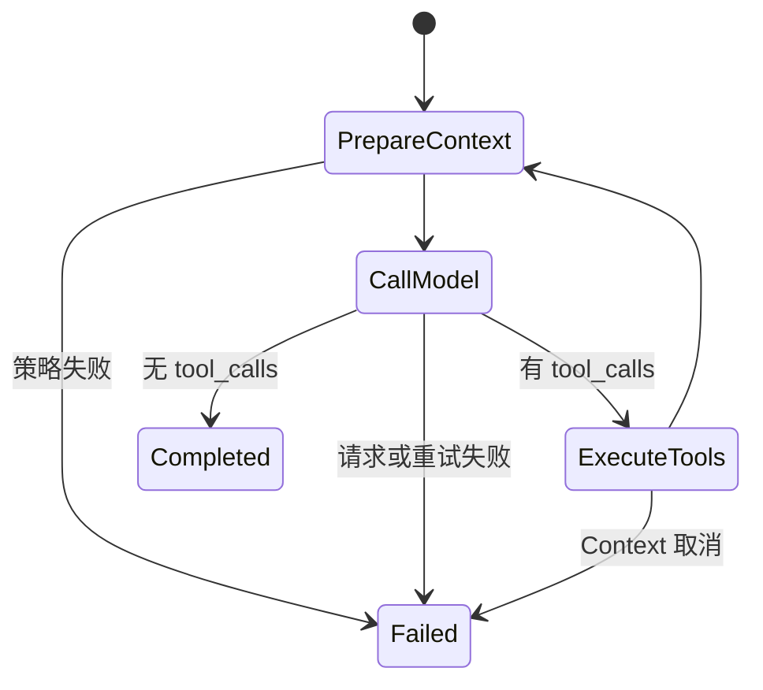

系列第五篇，阶段四解决两个边界问题：工具如何跨进程复用，以及消息历史增长后如何控制上下文。代码分别在 [agent-lab/ch04](https://github.com/jaguarnova/agent-lab/tree/main/ch04) 和 [data-agent](https://github.com/jaguarnova/data-agent)。

## 一、先手写 Client：理解 MCP 会话

最初的练习是一个约 200 行、零 SDK 依赖的 stdio Client。它把 MCP 生命周期拆成四步：

```text
spawn server
  → initialize / initialized
  → tools/list
  → tools/call
```

底层是 JSON-RPC 2.0：请求用 `id` 关联响应，notification 没有 `id`，工具参数由 `inputSchema` 描述。这个练习的价值不是维护另一套 SDK，而是看清握手、能力发现、调用和子进程生命周期。

当时连接官方 filesystem server 的实测输出是：

```text
✓ 握手完成，server: secure-filesystem-server 0.2.0
✓ 发现 14 个工具：read_text_file / write_file / edit_file / directory_tree
                    / search_files / move_file / get_file_info ...
✓ 调用 read_file → module github.com/jaguarnova/agent-lab ...
```

接入主 Agent 后，模型在 4 轮内完成 3 次工具调用，混用了本地 `sql_query` 和 MCP 的 `list_directory`、`read_text_file`。两种来源进入同一个 `agent.Tool` 集合；模型只依据 name、description 和 schema 选择。

## 二、工程实现改用官方 Go SDK

理解协议后继续维护手写 JSON-RPC 没有收益。当前数据 MCP Server 固定使用官方 `github.com/modelcontextprotocol/go-sdk` v1.7.0：

- SDK 负责 initialize、capability、JSON-RPC 帧和 typed tool schema；
- 业务层只实现 `DataSource`，协议 handler 不直接依赖 PostgreSQL；
- 进程内 transport 测试验证 discovery、structured content、错误结果和错误后的会话可继续使用；
- `cmd/data-agent-mcp` 使用 stdio，stdout 只写协议，诊断写 stderr。

这是一条干净的边界：SDK 管协议，`PostgresSource` 管数据库语义，`main` 管环境配置和生命周期。

## 三、三个数据工具与只读边界

| Tool | 输入 | 结果 |
|---|---|---|
| `list_tables` | 无 | allowlist schema 中的表和视图 |
| `describe_table` | `schema`、`table` | 列名、类型、可空性 |
| `query_readonly` | `query` | 列、行、是否因上限截断 |

`query_readonly` 不靠 `strings.HasPrefix(query, "SELECT")` 保护数据。真正的执行边界首先是 PostgreSQL `READ ONLY` 事务。每次执行还会：

- 设置 `statement_timeout`，并用 context deadline 同时约束元数据和查询；
- 设置 allowlist `search_path`，约束未限定名称；
- 先运行 `EXPLAIN (VERBOSE, FORMAT JSON)`，拒绝执行计划中来自 allowlist 外 schema 的关系；
- 应用 `MCP_MAX_ROWS`，限制返回给模型的行数。

schema/table 元数据查询使用参数；schema 在执行前检查 allowlist。生产环境仍要使用最小权限账号：只读事务与执行计划检查是重要边界，但不是完整 SQL 沙箱。

真实 PostgreSQL 17 + stdio integration smoke 的观测结果：

```text
fixture: 8 rows
totals: 华东 5700.50 / 华北 5450.00 / 华南 6620.00
PASS: row limit / 2s timeout / write rejection / schema rejection
PASS: 3-tool stdio discovery / query_readonly SELECT 1
```

测试由官方 SDK `CommandTransport` 启动真实 `data-agent-mcp` 进程。协议级错误测试还验证了一次业务错误返回 `isError=true` 后，同一 MCP 会话仍可继续调用。

## 四、Context Engineering：四种策略同基线对照

实验固定使用同一份 10 条消息历史，包含两组完整 assistant/tool 配对。Token 是统一启发式估算，目的只是比较策略，不是供应商计费数字。

- **baseline**：原样保留，提供共同基线。
- **truncate**：保留首条 system 和最新完整原子组；预算不足也不拆 tool 配对。
- **summarize**：把旧的完整组交给真实 `Summarizer` 接口，插入一条 history summary，再保留最近完整组。
- **offload**：把超过阈值的 tool 结果写入内容寻址文件，消息中保留引用、SHA-256 和 preview。

离线命令实际输出如下。summarize 行明确来自 **controlled summarizer fixture**：本机没有配置 `OPENAI_API_KEY`，因此没有声称调用过托管模型；HTTP adapter 另由 `httptest` 覆盖成功、HTTP 错误、坏 JSON、缺 choice 和空内容。

| 策略 | Tokens before | Tokens after | 变化 | Messages | Pairing | 附加观测 |
|---|---:|---:|---:|---:|---|---|
| baseline | 511 | 511 | 0.0% | 10 → 10 | valid | 无变换 |
| truncate | 511 | 37 | -92.8% | 10 → 3 | valid | 移除 7 条 |
| summarize（controlled fixture） | 511 | 338 | -33.9% | 10 → 6 | valid | summary usage 100/24 tokens，5ms |
| offload | 511 | 549 | +7.4% | 10 → 10 | valid | 2 文件，原文 735 bytes；目录来自 `mktemp -d` |

结果里最有价值的是 offload 反例：120-byte preview 加上 path、hash 等引用元数据后，估算上下文反而增加。**把内容写到文件不等于自动节省模型输入**；阈值和 preview 必须按真实数据测量。

## 五、配对完整性与原子写入

裁剪和摘要都以完整消息组为单位。assistant 声明的全部 tool call 必须紧跟对应 tool result；孤立结果、缺失结果和重复 ID 都会被拒绝。即使 system + 最新组本身已超过预算，策略也保留协议有效性，并报告实际 token，而不是生成一个更短但无法发送的历史。

offload 使用原文 SHA-256 作为文件名。写入流程是临时文件 → `Sync` → `Close` → `Rename`；目标已存在时重新计算 hash 后复用。所有写入成功前只修改消息副本，因此目录错误或写入失败不会污染调用者的原始历史。

## 六、映射到 LangGraph 思维

阶段四不引入 Python 或 LangGraph 运行依赖，只把现有 Go 循环映射为显式状态图：



| LangGraph | Go implementation |
|---|---|
| State | `[]agent.Message`, `agent.State`, `agent.Stats` |
| PrepareContext node | `agent.ApplyContext` before each model call |
| CallModel node | HTTP Chat Completions request in `agent.Run` |
| ExecuteTools node | `runTool` loop appending tool messages |
| Conditional edge | `len(msg.ToolCalls) == 0` selects completion or tools |
| Terminal states | `completed`, `max_rounds`, `error` |

Checkpoint/Resume 需要持久化状态，延后到 Memory/生产化阶段。本阶段不做只能在进程内“看起来像恢复”的占位实现。

## 七、限制与决策

1. Token 是字符和协议开销的估算值，不能替代供应商 usage 或账单。
2. Summary 会丢信息；缺少 Evaluation 时，不把它设为主项目默认策略。
3. Offloading 会产生本地文件，而且本次参数下没有减少上下文，所以不在主 Agent 默认启用。
4. 主项目只公开 `truncate` 和 `none`；前者默认预算 8000，后者用于对照。
5. 符合规范的 stdio MCP Server 必须让 stdout 保持协议纯净，日志写 stderr；Client 不应靠跳过任意非 JSON stdout 来掩盖 server 错误。

## 八、下一步：Eino

阶段五会评估 Eino 如何承接现有 `State`、工具和 Context 边界。判断标准不是“代码是否更短”，而是测试 seam、错误语义、可观测状态和协议约束能否保留。在这之前不提前加入 RAG、Memory 或 Evaluation。

---

本系列代码仓库：[agent-lab](https://github.com/jaguarnova/agent-lab)（练习）· [data-agent](https://github.com/jaguarnova/data-agent)（主项目）
